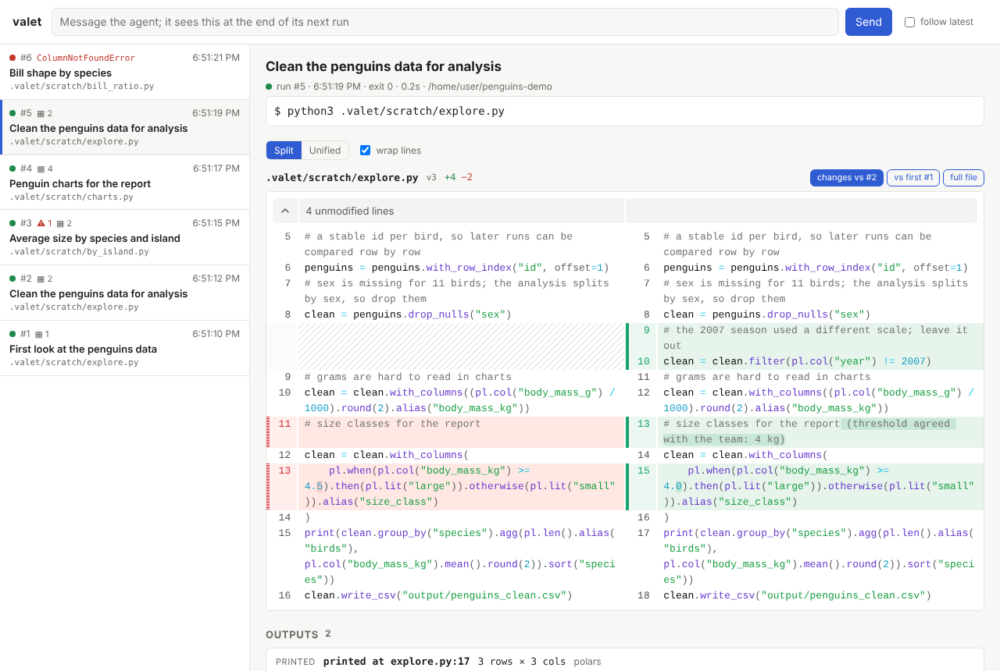
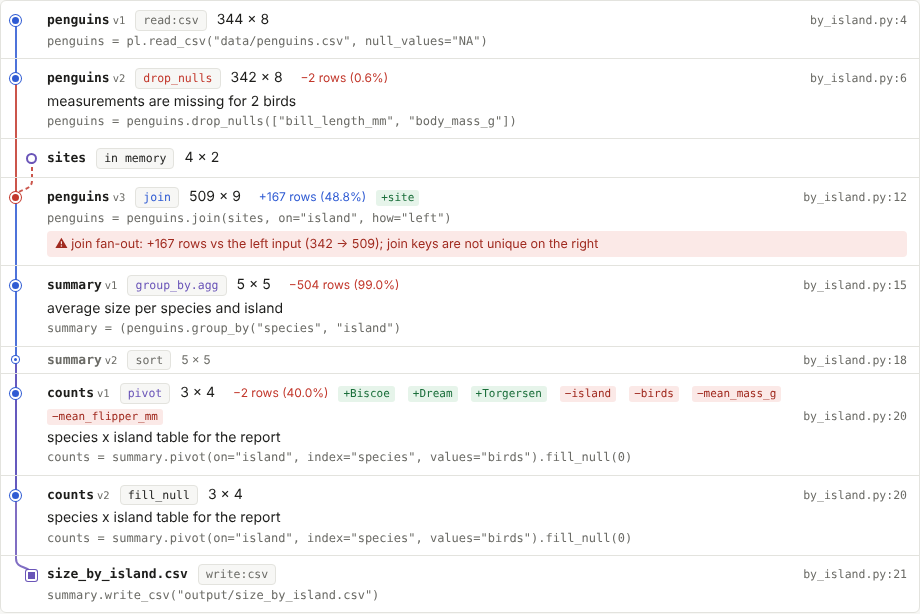
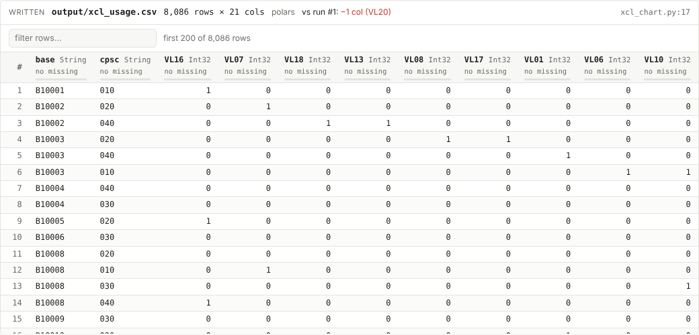
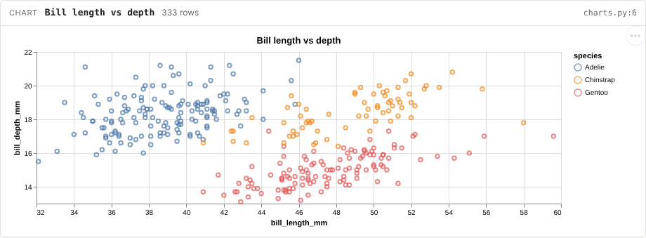
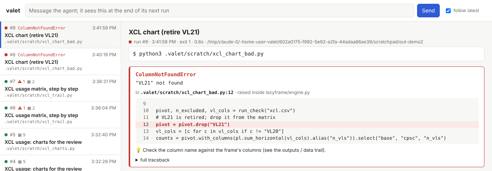
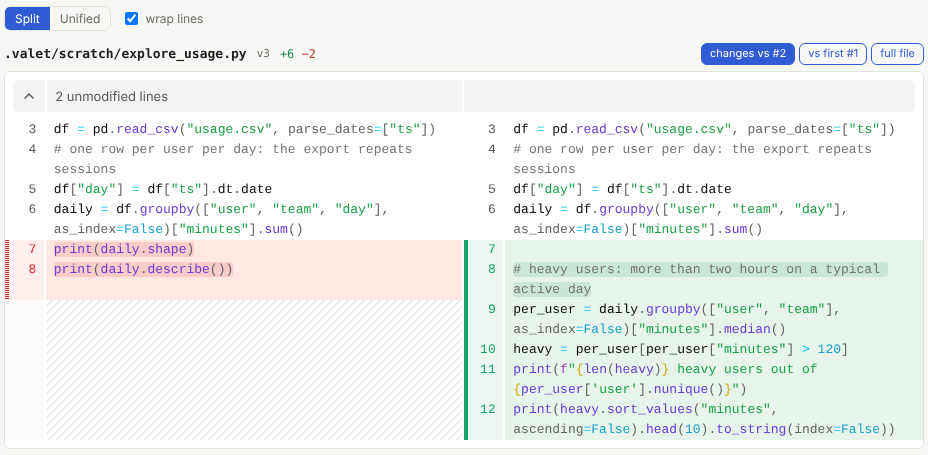

# valet

Coding agents like Amazon Q love to write a throwaway script, run it in the terminal,
tweak it, and run it again. Everything in that loop is ephemeral: the script gets
overwritten, the output scrolls away, and you can't redirect the agent until its turn ends.

**valet** is a tiny wrapper the agent runs its code *through*. Output still streams to
the terminal exactly as before, so the agent's own terminal tool sees it, and on top of that:

- **Every run is recorded**: command, working directory, exit code, duration, full output.
- **Every script version is kept, and easy to review**: each run snapshots the files it executed.
  The viewer shows each script as a syntax-highlighted split or unified diff against the previous
  run *or* against its first version (everything the agent changed this session), with word-level
  highlights and unchanged regions collapsed. Rendering uses
  [@pierre/diffs](https://diffs.com), the open-source library behind DiffsHub.
- **Inline code becomes durable**: `valet py -c "..."` and heredocs are saved to
  `.valet/scratch/` before they run.
- **You can steer**: type a message in the viewer (or `valet note "..."`), and it is appended
  to the output of the agent's *next* run as `[valet] Message from the user`. The agent's
  rules tell it to treat that as a direct instruction.
- **A transformation tree for pandas and polars**: every DataFrame transformation is recorded with its shape
  before and after, the keys it used, the line of code, and the `#` comment above it explaining
  why, and linked into a tree of which frame came from which. Click any node for a Data
  Wrangler-style preview (column types, % missing, sample rows). Joins that multiply rows are
  flagged, to you *and* to the agent.
- **Outputs as tables**: every DataFrame a run writes (`write_csv`, `to_parquet`, ...) or prints
  (`print(df.head(20))`), from pandas or polars, shows up as a sortable, filterable table with
  column types and % missing, compared against the same file from the previous run. CSV/TSV files
  and images (plots) written any other way are picked up too.
- **Charts in one line**: `import valet_view as vv; vv.chart(df, x=..., y=..., kind="bar")` draws
  an interactive chart in the viewer, from pandas, polars or plain lists, with nothing to install.
  HTML files a run writes are shown too, in a sandboxed frame.
- **Readable errors**: a failed run shows an error card with the exception, the line in *your*
  script that triggered it (not the library frame where it was raised), the surrounding code from
  the recorded version of the script, and a hint for common errors.
- **A live viewer**: `valet ui` serves a local page showing the run timeline, script
  diffs, outputs, the data trail, streaming output and queued notes.



It has zero dependencies (stdlib Python ≥ 3.9, SQLite) and makes no network calls apart from
the viewer on `127.0.0.1`, so it works behind a corporate VPN or proxy.

## Install

```bash
uv tool install git+https://github.com/adityapalve/valet
```

This puts `valet` on your PATH in its own isolated environment, so the agent's terminal finds it
whatever venv is active. (`pipx install …` or `pip install …` work too. For a private repo use
`git+ssh://git@github.com/adityapalve/valet`.) Upgrade with `uv tool upgrade valet`.

### No install: run from a clone

valet only uses the standard library, so nothing needs building. This is the route to use if
your network or endpoint policy blocks installers (e.g. uv or pip building wheels in a temp folder):

```bash
git clone git@github.com:adityapalve/valet.git ~/tools/valet
```

Then add the clone's `bin/` folder to your `PATH`. It has `valet` (macOS, Linux, Git Bash) and
`valet.cmd` (Windows cmd and PowerShell); both run `bin/_launch.py` with any Python ≥ 3.9 on your
PATH (`VALET_LAUNCH_PYTHON` overrides it). To update, `git pull`.

## Use with Amazon Q (or any agent with a terminal tool)

In your project:

```bash
valet init     # creates .valet/, adds it to .gitignore, writes .amazonq/rules/valet.md
valet ui       # starts the viewer in the background and opens http://127.0.0.1:8765
```

The rules file tells the agent to run Python as `valet py ...` and other commands as
`valet run -- ...`, keep scratch scripts in `.valet/scratch/` and edit them in place rather than
making `_v2` copies, keep output compact, and obey `[valet]` messages. For agents other than Q,
paste the same text (`valet/cli.py: RULES`) into their rules or `AGENTS.md`.

| command | what it does |
| --- | --- |
| `valet py script.py args…` | run a Python script (snapshotted) |
| `valet py -c "code"` / `valet py - <<'EOF'` | save the snippet to `.valet/scratch/`, then run it |
| `valet run -- cmd args…` | run any command; arguments that are files get snapshotted |
| `valet note "text"` | queue a message for the agent's next run |
| `valet log` / `valet show [id] [--full]` | browse runs from the terminal |
| `valet ui` | start the live viewer in the background (running it again just prints the URL) |
| `valet ui --stop` / `--status` | stop the viewer / check whether it's running |
| `valet doctor` | check the database and viewer, and say what to do about any problem |

### Data trail and transformation tree

When a script run through valet imports pandas or polars, valet records each transformation, with
no change to the code, and draws them as a tree. Each node is a version of a DataFrame, named after
the variable it was assigned to (`events v1 → v2 → v3`). Each edge is the operation that
produced it, and merges draw a dashed edge from the second input:



- **Recorded:** `read_*` / `to_*`, `merge` / `join` / `concat`, `drop_duplicates`, `dropna`,
  `drop`, `query`, boolean-mask filters (`df[mask]`, `df.loc[mask]`), `assign`, `rename`,
  `fillna`, `pivot` / `pivot_table` / `melt` / `explode`, column assignment (`df["x"] = …`), and
  groupby aggregations. `reset_index`, `sort_values`, `astype`, `copy` and similar are recorded
  as small "minor" nodes so the tree stays connected.
- **Recorded (polars):** `read_*` / `write_*`, `filter`, `join` (incl. anti/semi) / `join_asof`,
  `concat` / `vstack` / `hstack`, `with_columns`, `select`, `group_by(...).agg/len/sum/...`,
  `unique`, `pivot`, `unpivot`, `explode`, `drop`, `drop_nulls`, `fill_null`, `rename`, and
  `LazyFrame.collect()` (with its query plan); `sort`, `cast`, `with_row_index` as minor nodes.
  Parameters are read from each method's real signature, with expressions shown as text, e.g.
  `filter(col("base").str.starts_with("W5") | ...)`. Each step
  stores its parameters (dedupe `subset`, join `on` / `how`, groupby keys…), input and output
  shapes, columns added and removed, and the calling line.
- **The why:** the rules ask the agent to put a one-line `#` comment above each
  transformation (or above the whole statement, for chained calls). valet shows that comment as
  the step's description, so the trail reads like
  "one row per event_id: 5,300 → 5,000 rows".
- **Lineage:** frames are tracked by object identity (weak references; the frames themselves are
  never modified), so a step's inputs link to the nodes that produced them. Frames valet didn't
  see being created (e.g. built with `pd.DataFrame(...)`) become root nodes named after their
  variable.
- **Previews:** each node stores the first 5 rows, column dtypes and null counts (≤40 columns;
  nulls skipped above 5M cells). This is a copy of your data in `.valet/` (which `valet init`
  gitignores). Set `VALET_TRAIL_PROFILE=0` to record shapes only.
- **Warnings:** a left or inner join that *adds* rows (duplicate keys on the right), an inner join
  that drops rows, concat inputs with mismatched columns, or a step that empties the frame. These
  are also printed at the end of the run as `[valet] Data warnings`, so the agent sees them too.
- **How:** valet puts a stdlib-only `sitecustomize.py` on the child's `PYTHONPATH`. It patches
  pandas only once the script imports it, records only top-level calls (not pandas' internal
  ones), chains to any existing `sitecustomize`, and never raises into your code. It also works
  under `uv run --script`. Overhead is a shape lookup per call. Turn it off with
  `VALET_TRAIL_OFF=1`.

### Which Python runs the script (and where packages come from)

valet itself has no dependencies. The scripts it runs get their packages from:

1. **`$VALET_PYTHON`**, if set: always used.
2. **PEP 723 inline dependencies** (when uv is installed): a script with a header like
   ```python
   # /// script
   # dependencies = ["pandas", "pyarrow"]
   # ///
   ```
   runs as `uv run --script`, in an isolated environment that uv builds once and caches. The
   rules tell the agent to do this instead of `pip install`, so the dependencies are part of the
   script, and valet's snapshot of the script records them too.
3. **A uv project** (a `uv.lock` above the current directory): scripts run with `uv run python`,
   so they use the project's synced `.venv`.
4. Otherwise, **`python` / `python3` on `PATH`**, so an active venv is respected.

Set `VALET_UV=0` to turn off the uv behaviour. `$VALET_HOME` overrides where the `.valet/` store lives.

## Viewer lifecycle and troubleshooting

- `valet ui` returns immediately: the server runs as a background process. It's safe to run
  from an agent's terminal, and running it twice reuses the viewer that's already up.
- The viewer **stops by itself** after 30 minutes without requests (`--idle N` to change, `0`
  for never). An open tab keeps it alive.
- `valet ui --stop` asks the viewer to shut itself down over HTTP, so it works even if the process
  was started in a context you aren't allowed to kill (e.g. an agent's sandboxed terminal).
  `valet ui --foreground` runs it attached to your terminal instead (ctrl-c stops it).
- **Recording never blocks your command.** If the database can't be written within a few seconds
  (`VALET_DB_TIMEOUT`, default 5), valet prints `[valet] recording unavailable`, runs the command
  anyway with output and exit code intact, and stops recording for that run.
- `valet doctor` reports the Python in use, the database's journal mode and whether it's writable,
  and the viewer's state, with next steps if something's wrong.

**`database is locked` with valet < 0.4:** older versions kept a database connection open and
relied on CPython finishing a query as soon as its result was dropped. Under PyPy (and in some
error paths) queries stayed open, so the viewer held a write lock for as long as it ran. Since
0.4, every operation uses its own short-lived connection, reads every query to the end, and
closes it. The test suite checks this under PyPy too. If an old viewer is still running, end
that python process (or log out), then update.

### Outputs



- **Captured from the frame in memory.** When a pandas or polars DataFrame is written or printed
  from your code, the hook records its shape, column dtypes, null counts and first 200 rows, so it
  works for any format (CSV, parquet, Excel...). Printed frames keep a meaningful index (e.g. after
  a groupby).
- **Found on disk.** After each run, valet looks for CSV/TSV, image and other data files under the
  run's folder that changed during the run (skipping `.git`, `.valet`, virtualenvs and other
  hidden folders; at most 1.5s and 20 files). CSV/TSV files get a table preview with a row count;
  images (PNG, JPEG, GIF, WebP) are displayed. Turn it off with `VALET_SCAN_OUTPUTS=0`.
- **Compared to last time.** An output is compared with the same path in the previous run that
  produced it: rows added or removed, columns added or removed.
- **Told to the agent.** The run summary lists the outputs, e.g.
  `[valet] outputs: output/xcl_usage.csv (13,043 x 22)`.
- Sorting and filtering apply to the preview rows (the first 200). Previews are stored in
  `.valet/`; set `VALET_TRAIL_PROFILE=0` to keep data out of it, or `VALET_MAX_ARTIFACTS` to change
  the per-run limit (default 20).

### Charts



Every `valet py` run can `import valet_view` (valet puts it on the import path; it's stdlib-only):

```python
import valet_view as vv
vv.chart(df, x="vl", y="bases", kind="bar", sort="-y", title="Pairs per VL")
vv.chart(df, x="month", y="revenue", kind="line", color="region")
vv.chart(df, x="n_vls", kind="hist")                       # also: point, area, box, heatmap
vv.chart(df, x="team", y="minutes", agg="median", kind="bar")
vv.vega({...}, data=df)                                     # any Vega-Lite spec
vv.table(df.head(20), "Most widely used parts")             # a titled table
```

- Charts are [Vega-Lite](https://vega.github.io/vega-lite/) specs, drawn in the viewer with
  tooltips and PNG/SVG export (vega-embed is bundled in `valet/static/vega.js`, so it works offline).
  The agent rules point the agent at this helper instead of hand-written HTML.
- Counts, histograms and `agg=` charts are computed over **all** rows before anything is sent, so
  they're exact at any size. Charts of raw rows (points, lines without `agg`) use the first 5,000
  rows and say so, both in the viewer and in the `[valet] chart: ...` line the agent sees.
- HTML files a run writes appear in a sandboxed frame: their scripts run, but in an opaque origin
  that can't reach the viewer or its API (scripts from CDNs still load if your network allows).

### Errors



When a run exits non-zero, valet parses the last Python traceback in its output (chained
exceptions, multi-line messages from pandas/polars, Windows paths). The viewer shows the
exception type and message, the deepest frame in your own code (library frames and valet's
recording wrapper are skipped), the lines around it from the script *as it was in that run*, a hint
for common errors (missing module, missing file, missing column, ...) and the full traceback on
demand. Failed runs are tagged with the exception type in the sidebar.

### Run titles and snippets

Each run gets a readable title in the viewer: `valet py --title "XCL usage check" ...`, otherwise
the script's leading `#` comment or docstring, otherwise (for `-c` snippets) its first meaningful
statement. A one-line snippet like `import x; y = f(); print(y)` is saved one statement per line,
but only when the reformatted code parses to exactly the same program; it is the version that runs.
All text valet adds to the agent's output is plain ASCII, so Windows consoles show it correctly.

### Reviewing scripts



Each script header shows its version (`v3`), lines added and removed, and three views: **changes
vs the previous run**, **vs the first version** in this project, and the **full file**. The
split/unified and wrap settings are remembered in your browser; narrow screens always use unified.
Python, SQL, shell, JSON, YAML, TOML, Markdown and R are highlighted; other files are shown as
plain text.

The renderer is bundled in the package (`valet/static/diffs.js`, ~1 MB) and served by the viewer
itself, so it works offline and behind networks that block CDNs. It is built from pinned versions
by `tools/build-viewer` (see below); third-party licenses are in
`valet/static/THIRD_PARTY_LICENSES.txt`.

## Design notes

**Why a CLI wrapper rather than an MCP server?** The agent's built-in terminal tool can't be
hooked from outside, and an MCP server depends on the IDE extension allowing MCP (it may be
disabled by org policy). Every agent can run a shell command, so a wrapper plus a rules file
works everywhere, today.

**Why notes arrive at the end of a run.** You can't inject text into the agent's chat mid-turn,
but a tool result is something it is guaranteed to read. Attaching steering notes to the next
command's output is the most reliable channel available.

## Roadmap

- **Persistent kernel mode**: `valet py --kernel script.py` executes in a long-lived IPython
  kernel (via `jupyter_client` over ZMQ, not a Jupyter server), so state like a loaded dataframe
  survives between runs, and you can attach to the same kernel yourself
  (`jupyter console --existing`). Rich outputs (tables, plots) would go to the viewer while the
  agent gets a text summary.
- **Kernel helpers ("code mode")**: preload `h.peek(df)`, `h.plot(...)`, `h.ask("…")` into the
  kernel so the agent reaches the viewer through code.
- **Approve gate**: optionally hold a run until you click Run in the viewer, or edit the
  script before it runs (must stay inside the agent's command timeout).
- **Replay ("durable" state)**: valet already stores every script version in run order, so a
  crashed or reset session (or kernel) can be rebuilt with `valet replay --until 12`. Optionally,
  checkpoint DataFrames to parquet at chosen steps so replay can resume from there.
- **Data trail, more**: null-rate and key-uniqueness checks on join keys;
  `df.loc[mask, col] = …` updates; collapsing long runs of column assignments; a tree that spans
  runs (follow `report.csv` from the script that wrote it into the one that reads it).
- **Optional MCP front-end** over the same store, for agents/IDEs where MCP is available.
- **Workspace diffs**: also record files the scripts *wrote*, not just the ones they ran.
  Zed's DeltaDB (operation-level history, private beta as of late 2026) is worth watching here.

## Developing

```bash
python -m pytest -q
```

To rebuild the bundled viewer libraries (only needed when upgrading them; requires Node):

```bash
cd tools/build-viewer && npm ci && node build.mjs
```

The build keeps only the grammars valet highlights and Pierre's own light/dark themes, and stubs
out the WASM highlighter backends, taking the bundle from ~11 MB to ~1 MB. `@pierre/diffs` 1.6.0
fails to load themes with the `@pierre/theming` version it pins; 1.6.1 is the first release that
works.
